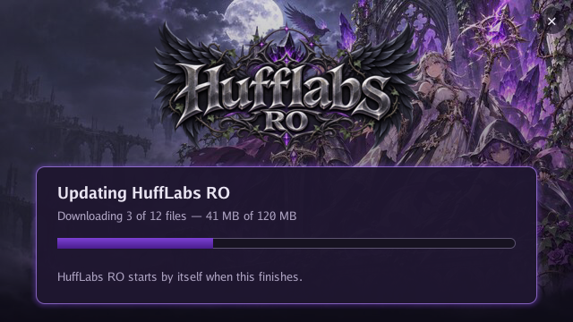
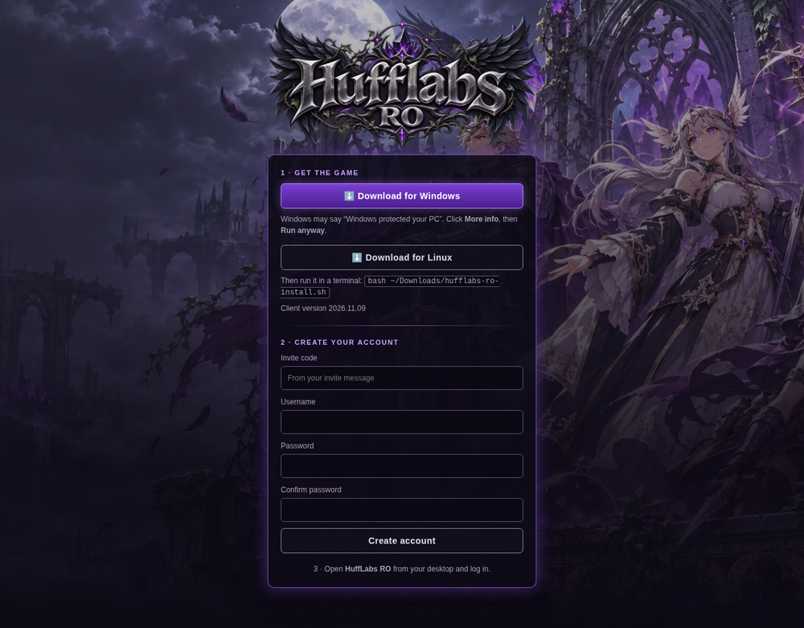
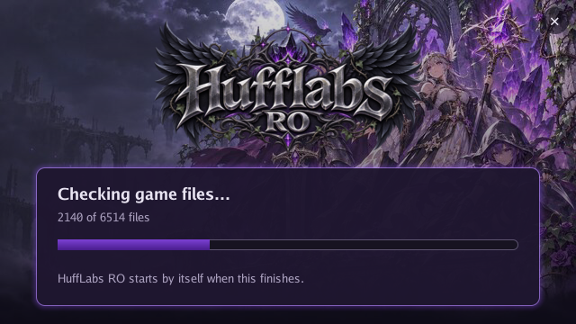
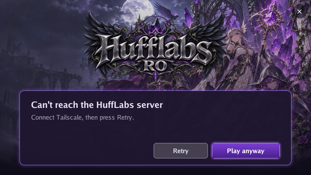
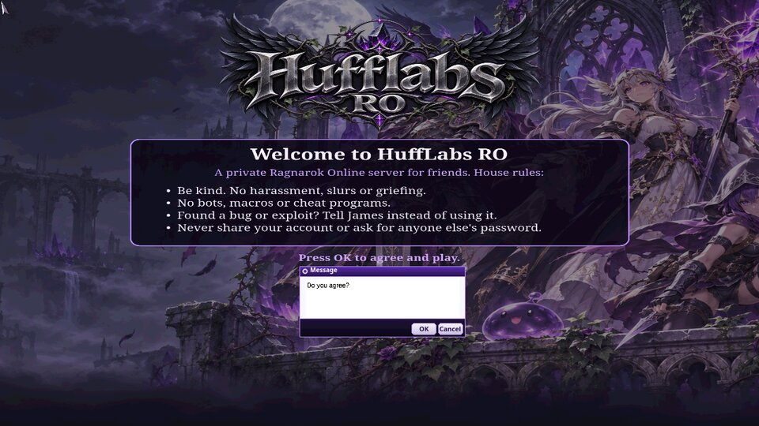
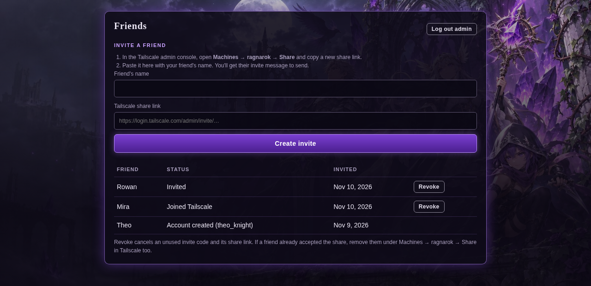
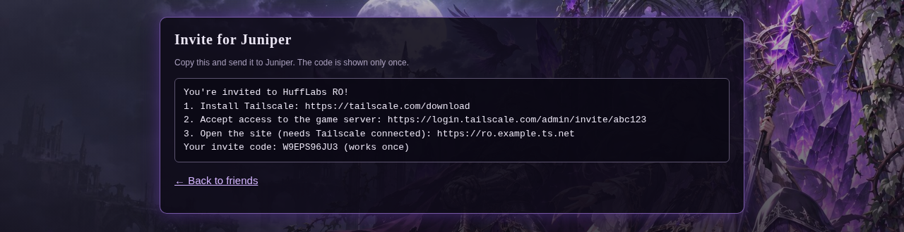

# HuffLabs RO

[](https://github.com/n0rthstar88/hufflabs-ro/actions/workflows/ci.yml)
[](https://github.com/n0rthstar88/hufflabs-ro/releases)

Tooling for a small, private Ragnarok Online server run for a group of friends: an
invite-only sign-up site, Windows and Linux installers, a themed client, and a
launcher that keeps every friend's game up to date by itself.

It sits next to an [rAthena](https://github.com/rathena/rathena) server that is
reachable only over [Tailscale](https://tailscale.com): friends get a Tailscale share
of the server's machine, an invite code, and nothing else.

> **Not affiliated with Gravity.** Ragnarok Online, its client and its game files are
> owned by Gravity Co., Ltd. This repository contains **no** Ragnarok Online client
> files, game data or executables — only original code, scripts and artwork. To use
> it you need your own client.



## What friends see

| Sign up with an invite code | Updates on every start | The themed client |
|---|---|---|
|  |   |  |

1. You create an invite on the admin page: the friend's name plus a Tailscale share
   link. The site writes the message to send them, with a one-time code.
2. They install Tailscale, accept the share, open the site, create their game account
   and download the installer.
3. They open HuffLabs RO. The launcher checks the server, downloads only the files
   that changed, then starts the game. If the server can't be reached it offers
   **Retry** or **Play anyway**.

| Admin page | Invite message |
|---|---|
|  |  |

## What's in here

| Path | What it is |
|---|---|
| `cmd/hufflabs-portal`, `internal/web`, `internal/store`, … | The sign-up site (Go): invite codes, account creation in rAthena's `login` table, the admin page, the download page and the launcher's update files. Runs behind `tailscale serve`. |
| `cmd/hufflabs-ro-launcher`, `internal/update`, `internal/manifest` | The launcher: a small self-drawn Windows window that verifies a signed file list, downloads changed files with resume, swaps them in atomically, updates itself, then starts the game. Linux runs the same exe through Proton (`umu-run`). |
| `cmd/hufflabs-ro-publish` | One command to publish your changes: builds the file list from your client folder plus the theme, uploads only new files, then switches the live list. |
| `installer/linux`, `installer/windows` | The installers: download the client archive once (resuming, checksum-verified), write default settings, install the launcher and shortcuts. |
| `theme/`, `cmd/themetool`, `cmd/grftool`, `internal/grf`, `internal/recolor`, `internal/tga` | Builds the client theme (login screen, rules page, dialogs) from your own artwork and the client's own interface files. |
| `client/` | Release scripts: the first-install archive, publishing the installers, switching versions without a gap. |
| `deploy/` | Container setup and deployment of the site. |
| `tailscale/policy-snippet.hujson` | The policy grant that limits friends to the game server. |
| `content/coin-shop/` | HuffLabs Coin: a coin that drops from monsters (more from bosses) and two Prontera merchants that sell costumes and gear for it. Server scripts, item entries, the client item descriptions and a deploy script. |
| `content/leveling/` | Leveling: each character picks normal or 15x XP at first login, max level 500/250 for final classes, stats up to 1,000 and tougher bosses, plus an `@menu` command menu (with a HUD button) and healers in every town. A small rAthena source patch, generated XP and stat tables, and the client patch profile. See its README. |

## Running your own

See **[docs/setup.md](docs/setup.md)**. In short: an rAthena server with MariaDB in a
container you can reach with `ssh <host> pct exec <id>` (Proxmox), Tailscale with
HTTPS certificates, Go 1.27, NSIS 3, and your own Ragnarok Online client.

How the update channel and the site are protected, and what they don't protect
against: **[docs/security.md](docs/security.md)**.

## Tests

```bash
go test ./...                              # site, launcher, updater, publish tool
bash installer/linux/test-install.sh       # Linux installer against a local fake site
bash installer/windows/test-nsis.sh        # installer folder/registry logic, under Wine
bash client/test-swap-release.sh           # release switch-over on the server
python3 -I -m unittest discover -s content/leveling/tests   # needs rAthena's db/re tables in content/leveling/upstream/
```

The store tests need throwaway `ptest_*` databases; see `deploy/test-store-remote.sh`.
On GitHub every push runs all of these on fresh Linux and Windows machines
(`.github/workflows/ci.yml`), with a throwaway MariaDB for the store tests. What
changed in each version: [CHANGELOG.md](CHANGELOG.md).

## License

MIT, see [LICENSE](LICENSE). That covers the code and the HuffLabs RO artwork in this
repository. It does not cover Ragnarok Online itself or anything from Gravity.
